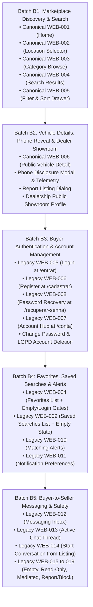

# Feira de Carros — Buyer Website Pre-Implementation Comprehensive Audit Report

**Phase:** Buyer Website Frontend Discovery & Pre-Implementation Audit  
**Audit Date:** November 17, 2026  
**Auditor Roles:** Principal Frontend Architect, Senior Next.js Engineer, Figma-to-Code Implementation Specialist, QA Automation Lead  
**Target Repository:** `mridha-rakib/feira-de-carros`  
**Target Application:** `apps/web` (Next.js 15 App Router)  
**Verified Base Commit:** `9b50cd25c6cadea83d93d9f7342100a390881cf6` (`origin/main`)  
**Figma Source of Truth:** `JlRZIGImV7rRROPZndv6NT` (Canvas Node `733:2`: `10 · BUYER + SHARED + DEALERSHIP PUBLIC / RESPONSIVE UI`)  
**Scope Restriction:** Strictly read-only audit. No application source code modified, no commits created.

---

## 1. Executive Summary & Verification Context

Prior to beginning development of the **Buyer Website** (customer-facing marketplace, discovery, vehicle details, favorites, searches, buyer identity, and messaging), an exhaustive pre-implementation audit was conducted across the codebase, Monorepo structure, and the approved Figma design specifications.

### Summary of System Status
1. **Repository Health:** The repository is fully green and stable. All quality gates pass with zero errors:
   - **Biome Lint & Format:** 331 files checked, 0 errors, 0 warnings.
   - **TypeScript Typecheck:** 7 monorepo packages checked, 0 errors.
   - **Vitest Unit/Integration Tests:** 168 tests across 6 packages passing (64 tests in `apps/web`, 89 in `apps/admin`).
   - **Production Next.js Build:** Turborepo build passes cleanly for both `apps/web` (42 static/dynamic routes) and `apps/admin` (34 static/dynamic routes).
2. **Seller Implementation Status:** The Individual Seller portal (`/vendedor/*`, `/seller/*`) is 100% implemented across all 29 planned screens (Batches S1–S5), thoroughly tested, audited in Phase 12, and merged into `main`.
3. **Admin Implementation Status:** The Staff Back-office (`apps/admin`) is completely implemented and frozen.
4. **Buyer Implementation Status:** The Buyer experience is currently in an unmigrated scaffold state. The homepage (`apps/web/app/page.tsx`) contains placeholder mock components pointing to broken or outdated routes (`/search`, `/dealerships`, `/pricing`, `/car/veh-1`). Canonical search, vehicle details, category exploration, favorites, saved searches, buyer authentication, and buyer messaging are not yet implemented.

---

## 2. Monorepo Architecture & Invariants

### 2.1 Workspace Structure
The project operates as a Turborepo monorepo managed with `pnpm` (`pnpm-workspace.yaml`):

```
feira-de-carros/
├── apps/
│   ├── web/                    # Customer-facing app: Buyer, Individual Seller, Dealership
│   │   ├── app/                # Next.js 15 App Router
│   │   │   ├── ajuda/          # Shared Help Center / FAQ (Implemented in S5)
│   │   │   ├── conta/          # Customer Account Settings (Implemented in S5)
│   │   │   ├── entrar/         # Canonical Customer Login (Institutional Placeholder)
│   │   │   ├── login/          # Redirects to /entrar
│   │   │   ├── privacidade/    # Shared Privacy Policy / LGPD (Implemented in S5)
│   │   │   ├── seller/         # Backward-compatible redirects to /vendedor
│   │   │   ├── vendedor/       # Individual Seller Portal (26 screens complete)
│   │   │   ├── layout.tsx      # Root layout
│   │   │   └── page.tsx        # Homepage (Scaffold, needs canonical replacement)
│   │   ├── lib/
│   │   │   ├── adapters/       # Client-side data adapters & mock fixtures
│   │   │   ├── constants/      # Plan configurations, fee schedules
│   │   │   └── types/          # TypeScript domain models
│   │   └── middleware.ts       # Route security & session redirection
│   └── admin/                  # Staff Back-office (Main Admin, Sales, Support) - FROZEN
├── packages/
│   ├── api-client/             # Typed API contracts (OpenAPI v0.2 alignment)
│   ├── logger/                 # Structured isomorphic logger
│   ├── testing/                # Shared test utilities
│   ├── typescript-config/      # Shared tsconfig bases
│   └── ui/                     # Design system primitives & brand tokens
└── docs/                       # Project documentation & QA audits
```

### 2.2 Core Architectural Invariants
1. **Monorepo Boundary Rule:** `apps/web` contains the Buyer, Seller, and Dealership public experiences. `apps/admin` is strictly isolated for staff. No code or components should be duplicated between `apps/web` and `apps/admin`.
2. **Backend Separation Rule:** No direct database connections, ORMs, or server-side SQL queries inside Next.js routes. All communication must run through `@feira/api-client`.
3. **Session vs. Role Rule:** The presence of `fdc_web_session` cookie indicates an authenticated session at edge middleware, but fine-grained authorization (e.g., verifying if the user has role `buyer`, `seller`, or `dealer`) remains authoritative via backend API endpoints.
4. **LGPD & PII Data Protection:** No plain-text CPF or unredacted personal details. Mock data must carry explicit `DEMO DATA` provenance.

---

## 3. Buyer Figma Design System & Screen Inventory

### 3.1 Source of Truth
- **Figma File:** `JlRZIGImV7rRROPZndv6NT`
- **Primary Section:** Canvas Node `733:2` (`10 · BUYER + SHARED + DEALERSHIP PUBLIC / RESPONSIVE UI`)
- **Key Design Tokens:**
  - Primary Brand Red: `#F42524`
  - Semantic Red Dark / UI Primary: `#c41217` / `#B91C1C`
  - Neutral Background: `#F8F9FB` / `#FFFFFF`
  - Text Primary: `#111827` / `#101828`
  - Text Secondary: `#566273` / `#6B7280`
  - Card Border: `#E2E7EE` / `#D6DFEA`
  - Breakpoints: Desktop `1440px` & `1366px`, Tablet `768px`, Mobile `390px` & `430px`

### 3.2 Complete Inventory of Buyer Figma Frames

| Canonical / Legacy ID | Screen / Flow Name | Desktop Node ID | Mobile Node ID | Planned Route |
|---|---|---|---|---|
| **WEB-001 (Canonical)** | Marketplace Home / Hero / Categories / Featured | `733:3` | `733:51` | `/` |
| **WEB-002 (Canonical)** | Manual City / State Location Modal & Selector | `1266:1082` | `1266:1157` | `/localidade` (or modal) |
| **WEB-003 (Canonical)** | Category & Body Type Browse | `1267:1109` | `1267:1186` | `/categorias` |
| **WEB-004 (Canonical)** | Vehicle Search Results (Legacy WEB-002) | `733:87` | `733:139` | `/veiculos` |
| **WEB-005 (Canonical)** | Search Filter & Sort Drawer / Sidebar | `1212:3646` | `1212:3739` | `/veiculos` (drawer/sidebar) |
| **WEB-006 (Canonical)** | Public Vehicle Detail Page (Legacy WEB-003) | `733:179` | `733:208` | `/veiculos/[id]` |
| **WEB-004 (Legacy)** | Registered Favorites List | `733:232` | `733:274` | `/favoritos` |
| **WEB-004-E (Legacy)** | Favorites — Empty State | `840:110` | `840:527` | `/favoritos` |
| **WEB-004-L (Legacy)** | Favorites — Login Required State | `840:317` | `840:646` | `/favoritos` |
| **WEB-005 (Legacy)** | Buyer Login Screen (Phase 02B) | `845:164` | `845:188` | `/entrar` |
| **WEB-006 (Legacy)** | Buyer Registration Screen (Phase 02B) | `845:212` | `845:241` | `/cadastrar` |
| **WEB-007 (Legacy)** | Buyer Account Dashboard / Profile (Phase 02B) | `845:270` | `845:293` | `/conta` |
| **WEB-008 (Legacy)** | Password Recovery Request (Phase 02B) | `845:316` | `845:333` | `/recuperar-senha` |
| **WEB-009 (Legacy)** | Saved Searches List (Phase 02C) | `856:165` | `856:192` | `/buscas-salvas` |
| **WEB-009-E (Legacy)** | Saved Searches — Empty State | `1303:1217` | `1303:1305` | `/buscas-salvas` |
| **WEB-010 (Legacy)** | Matching Alerts Configuration (Phase 02C) | `856:219` | `856:240` | `/conta/alertas` |
| **WEB-011 (Legacy)** | Notification Preferences (Phase 02C) | `856:261` | `856:282` | `/conta/notificacoes` |
| **WEB-012 (Legacy)** | Buyer Messaging Inbox (Phase 02D) | `1168:202` | `1168:266` | `/mensagens` |
| **WEB-013 (Legacy)** | Active Conversation Chat Thread (Phase 02D) | `1168:310` | `1168:369` | `/mensagens/[id]` |
| **WEB-014 (Legacy)** | Start Conversation from Listing (Phase 02D) | `1168:419` | `1168:458` | `/veiculos/[id]/conversar` |
| **WEB-015 (Legacy)** | Messaging Login Required Gate (Phase 02D) | `1168:488` | `1168:527` | `/mensagens` (gate) |
| **WEB-016 (Legacy)** | Empty Messaging Inbox (Phase 02D) | `1168:557` | `1168:590` | `/mensagens` (empty) |
| **WEB-017 (Legacy)** | Report & Block Counterpart Modals (Phase 02D) | `1168:614` | `1168:658` | `/mensagens/[id]/acoes` |
| **WEB-018 (Legacy)** | Read-Only Conversation (Vehicle Sold/Suspended) | `1168:693` | `1168:746` | `/mensagens/[id]` (banner) |
| **WEB-019 (Legacy)** | Team Mediated Conversation Dispute | `1168:790` | `1168:846` | `/mensagens/[id]` (badge) |
| **PHASE-03B-P** | Seller Phone Revealed Modal / State | `1211:2518` | `1211:2561` | `/veiculos/[id]` (modal) |
| **PHASE-03B-CP** | Change Password Form | `1212:524` | `1212:577` | `/conta/senha` |
| **PHASE-03B-CPU** | Password Successfully Updated Confirmation | `1212:619` | `1212:660` | `/conta/senha` |
| **PHASE-03B-DEL** | Delete Account Request Form (LGPD) | `1212:690` | `1212:735` | `/conta/exclusao` |
| **PHASE-03B-DELS**| Deletion Request Submitted Confirmation | `1212:769` | `1212:809` | `/conta/exclusao` |
| **PHASE-03B-EMP** | No Search Results State | `1212:3807` | `1212:3853` | `/veiculos` (empty) |
| **PHASE-03B-REP** | Report Vehicle Listing Modal | `1212:3890` | `1212:3938` | `/veiculos/[id]` (modal) |
| **PHASE-03B-REPS**| Vehicle Report Submitted Confirmation | `1212:3977` | `1212:4023` | `/veiculos/[id]` (modal) |
| **DEALER-SHOW** | Dealership Public Showroom Profile | `1211:2395` | `1211:2461` | `/concessionarias/[id]` |
| **PHASE-04A-D** | Notification Center (Unread/Read) *(SRS HOLD)* | `1357:2138` | `1357:2192` | Deferred / On Hold |

---

## 4. Buyer Implementation Coverage Matrix

| Area | Feature / Screen | Canonical Figma Reference | Code Location | Status | Implementation Gaps & Notes |
|---|---|---|---|---|---|
| **Public** | Marketplace Home | `733:3` / `733:51` | `apps/web/app/page.tsx` | **Scaffold (Outdated)** | Old template with generic cards; links to `/search`, `/car/veh-1`. Needs full redesign to match Figma header, location chip, category carousels, brand grid, and featured vehicles. |
| **Public** | Location Selector | `1266:1082` / `1266:1157` | None | **Missing** | Modal / drawer component to select Brazilian State (UF) and City with postal code lookup. |
| **Public** | Category Browse | `1267:1109` / `1267:1186` | None | **Missing** | Dedicated grid of vehicle body types (Sedã, SUV, Hatchback, Picape, Cupê, Elétrico/Híbrido) with counts. |
| **Public** | Search Results | `733:87` / `733:139` | None | **Missing** | Vehicle cards grid with price, year, mileage, city, badge, favorite toggle, pagination, and sorting dropdown. |
| **Public** | Filter & Sort | `1212:3646` / `1212:3739` | None | **Missing** | Desktop sidebar and responsive mobile bottom sheet for filtering by Make, Model, Year, Price, Mileage, Fuel, Transmission. |
| **Public** | Vehicle Detail | `733:179` / `733:208` | None | **Missing** | Full vehicle page with photo gallery, technical specs, seller info, safety badges, contact seller CTA, report vehicle trigger. |
| **Public** | Dealer Showroom | `1211:2395` / `1211:2461` | None | **Missing** | Public dealership showroom page with dealer banner, address, verified seal, opening hours, and active stock list. |
| **Auth** | Login | `845:164` / `845:188` | `apps/web/app/entrar/page.tsx` | **Placeholder** | Static placeholder with disabled inputs and demo notice. Needs full Figma form matching with email/password validation. |
| **Auth** | Registration | `845:212` / `845:241` | None | **Missing** | Buyer sign-up form with name, email, phone, password, terms acceptance, and LGPD opt-in. |
| **Auth** | Password Recovery| `845:316` / `845:333` | None | **Missing** | Password recovery request form with email dispatch feedback and security guidance. |
| **Account**| Account Profile | `845:270` / `845:293` | `apps/web/app/conta/configuracoes` | **Partial** | Settings page implemented in S5. Main `/conta` buyer hub dashboard with shortcuts (favorites, searches, messages) needs creation. |
| **Account**| Change Password | `1212:524` / `1212:577` | None | **Missing** | Form requiring current password, new password with strength indicator, and confirmation. |
| **Account**| Account Deletion| `1212:690` / `1212:735` | None | **Missing** | LGPD deletion request flow explaining data retention limits, pending transactions, and protocol generation. |
| **Buyer** | Favorites | `733:232` / `733:274` | None | **Missing** | Authenticated favorites list with vehicle cards, remove action, empty state (`840:110`), and guest login prompt (`840:317`). |
| **Buyer** | Saved Searches | `856:165` / `856:192` | None | **Missing** | List of saved filter configurations with alert toggles, edit/delete actions, and empty state (`1303:1217`). |
| **Buyer** | Matching Alerts | `856:219` / `856:240` | None | **Missing** | Real-time / daily digest match settings for saved searches. |
| **Messaging**| Inbox | `1168:202` / `1168:266` | None | **Missing** | Buyer inbox listing conversation threads with sellers/dealers, unread badges, vehicle thumbnails. |
| **Messaging**| Chat Thread | `1168:310` / `1168:369` | None | **Missing** | Real-time chat UI with vehicle info header, message history, safety reminder banner, attachment/report options. |
| **Messaging**| Start Chat | `1168:419` / `1168:458` | None | **Missing** | Quick inquiry composer launched directly from the vehicle detail page. |
| **Safety** | Phone Reveal | `1211:2518` / `1211:2561` | None | **Missing** | Lead capture dialog / reveal flow logging phone view for anti-scraping and seller telemetry. |
| **Safety** | Listing Report | `1212:3890` / `1212:3938` | None | **Missing** | Modal for reporting fraudulent listings, incorrect price, already sold, or inappropriate content. |

---

## 5. Reusable Components, Adapters & Primitives

An extensive inventory of reusable assets already exists in the repository, significantly reducing boilerplate for the Buyer implementation:

### 5.1 Shared UI Primitives (`packages/ui`)
- `BrandLogo`: Supports `on-light`, `on-dark`, `mono-black`, and `mono-white` variants with official brand dimensions (`178x36`).
- `Button`: Primary, secondary, outline, ghost, accent, and destructive variants with sizes `sm`, `default`, `lg`.
- `Badge`: Status and indicator badges (`default`, `secondary`, `destructive`, `outline`, `success`, `warning`, `info`).
- `Card`, `CardHeader`, `CardTitle`, `CardContent`, `CardFooter`: Standardized card containers matching `#E2E7EE` border styling.
- `Input`, `Label`: Form field primitives with accessible labels and ring focus styling.
- `Skeleton`: Loading placeholders for async states.

### 5.2 Application Components (`apps/web/app/components`)
- `SellerIcons.tsx`: Despite its name, this file provides **over 40 clean, SVG icons** matching the Figma design tokens:
  - Navigation & Action: `IconSearch`, `IconHeart`, `IconCar`, `IconFilter`, `IconSort`, `IconChevronDown`, `IconChevronRight`, `IconArrowLeft`, `IconCross`.
  - Identity & Security: `IconLock`, `IconMail`, `IconPhone`, `IconShieldAlert`, `IconShieldCheck`, `IconEye`, `IconEyeOff`, `IconAlertTriangle`.
  - Communication: `IconMessageCircle`, `IconSend`, `IconPaperclip`, `IconDotsVertical`.
  - Utility: `IconCheck`, `IconClock`, `IconHelpCircle`, `IconShare`, `IconMapPin`, `IconCalendar`, `IconGauge`.
- `VehicleStatusBadge.tsx`: Badges for vehicle status (`draft`, `pending`, `published`, `sold`, `rejected`). Can be reused or expanded for buyer listing badges (`Destaque`, `Garantia`, `IPVA Pago`).

### 5.3 Shared Adapters & Fixtures (`apps/web/lib/adapters`)
- `seller-listings-adapter.ts`:
  - Contains rich vehicle models, categories (`sedan`, `suv`, `hatchback`, `pickup`, `coupe`, `electric`), and 10+ realistic Brazilian vehicle fixtures (Toyota Corolla, Jeep Compass, BYD Dolphin, Honda Civic, Hyundai Creta, VW T-Cross, etc.) with photos, specs, prices, and locations.
  - Can serve as the seed data source for buyer vehicle search and vehicle detail pages.
- `user-account-adapter.ts`:
  - Profile data model with masked CPF and contact preferences.
- `seller-messages-adapter.ts`:
  - Full messaging thread data structures, message types (`text`, `system`, `action`), and safety actions (`report`, `block`) directly applicable to the buyer messaging client.

### 5.4 Shared Legal & Support Routes
- `/privacidade`: Completed in S5. Fully responsive, conformed to LGPD, live and reusable.
- `/ajuda`: Completed in S5. Interactive FAQ accordion with category search, contact channels, live and reusable.

---

## 6. Detailed Analysis of Missing Features & Gaps

### 6.1 Public Discovery & Catalog Navigation
1. **Homepage Discrepancy:** The current `apps/web/app/page.tsx` was built as a generic wireframe during initial monorepo bootstrapping. It does not reflect Figma `733:3` / `733:51`:
   - Lacks the top search bar with the City/State selector pill ("São Paulo - SP").
   - Lacks vehicular body type selector cards with custom vehicle silhouettes.
   - Lacks popular make/brand shortcuts with brand logos.
   - Navigation links point to `/search`, `/dealerships`, and `/pricing` instead of canonical `/veiculos`, `/concessionarias`, and `/vendedor/solicitacao`.
2. **Search Results & Catalog (`/veiculos`):**
   - Need a dedicated route with server-side / static query parsing.
   - Filter criteria: Location (UF/City), Make, Model, Year min/max, Price min/max, Mileage max, Transmission, Fuel, Seller type (Particular / Loja).
   - Card displays: Badge, image carousel, price (BRL formatting), vehicle title, version subtitle, year/mileage/transmission, city/state, and favorite button.
3. **Public Vehicle Detail Page (`/veiculos/[id]`):**
   - Full photo gallery with main image preview and thumbnail navigation.
   - Overview specs: Year, Mileage, Fuel, Gearbox, Color, Doors, End of Plate.
   - Safety checks: Cautelar Vistoriada, IPVA Pago, Único Dono, Todas as Revisões em Concessionária.
   - Equipment list grouped by category: Conforto, Segurança, Infotenimento.
   - Seller information card: Name/Dealer name, member since, response time, location map placeholder.
   - Sticky contact bar for mobile (`Ligar`, `Enviar Mensagem`).

### 6.2 Buyer Authentication & Profile Management
1. **Authentication Routing:**
   - Canonical login is `/entrar` (with `/login` redirecting to `/entrar`).
   - Need registration at `/cadastrar` and recovery at `/recuperar-senha`.
   - Forms must validate email format, Brazilian phone format `(XX) 9XXXX-XXXX`, and password rules.
2. **Account Dashboard (`/conta`):**
   - Serves as the landing hub for buyers: summary of active inquiries/messages, saved favorites count, saved searches alerts, and link to `/conta/configuracoes`.
   - Security flows: Password change (`/conta/senha`) and LGPD account deletion (`/conta/exclusao`).

### 6.3 Favorites & Saved Searches
1. **Favorites Management:**
   - Unauthenticated state: If a guest clicks the favorite heart or accesses `/favoritos`, prompt with an inline modal or redirect to `/entrar` with return parameter.
   - Authenticated state: Grid of saved cars with real-time add/remove functionality.
   - Empty state: Engaging illustration encouraging exploration of featured cars.
2. **Saved Searches & Alerts:**
   - Ability to save any search filter combination from `/veiculos`.
   - Management page at `/buscas-salvas` showing query summary chips (e.g., `SUV · 2020+ · Até R$ 120.000 · São Paulo`).
   - Push / email notification frequency toggles.

### 6.4 Buyer-to-Seller Messaging
1. **Inbox & Chat Thread:**
   - Desktop 2-column layout (thread list on left, active chat on right).
   - Mobile stacked layout (`/mensagens` -> `/mensagens/[id]`).
   - Thread header displays vehicle card summary with quick link back to vehicle detail.
   - Message bubbles distinguish Buyer (right, red accent / slate) from Seller (left, gray).
   - Safety dialogs: Report user, block conversation, mediated flag notice.

---

## 7. Visual Fidelity & Usability Observations

1. **Header Consistency:**
   - `apps/web` currently has `SellerNavbar` (for `/vendedor/*`) and a basic header in `apps/web/app/page.tsx`.
   - Buyer needs a dedicated `BuyerHeader` (or unified `MarketplaceHeader`) that accommodates:
     - Feira de Carros Logo.
     - Location pill button with Pin icon (e.g., "São Paulo, SP" clicking opens city modal).
     - Search input field.
     - "Favoritos" link with Heart icon and count badge.
     - "Mensagens" link with Chat icon and unread count badge.
     - User Avatar / "Entrar" button.
     - "Vender Meu Carro" CTA button (`#F42524`).
2. **Mobile Sticky Bottom Bar:**
   - On mobile, `MarketplaceBottomNav` should feature 4 or 5 primary tabs: `Início`, `Buscar`, `Favoritos`, `Mensagens`, `Menu / Perfil`.
   - Must match the height (`64px`), font size (`10px`), active state coloring (`#c41217`), and safe area padding used in `SellerMobileBottomNav`.
3. **Design System Consistency:**
   - Colors must strictly use `#F42524` (brand logo/accents), `#c41217` / `#B91C1C` (UI primary buttons), `#111827` (titles), `#566273` (body text), and `#E2E7EE` (card borders).

---

## 8. Architecture, Security & LGPD Invariants

1. **Fail-Closed Route Protection:**
   - Middleware currently protects:
     ```ts
     const PROTECTED_PREFIXES = ['/buyer', '/seller', '/dealer', '/vendedor', '/conta'];
     ```
   - Must be expanded to protect buyer private sections:
     ```ts
     const PROTECTED_PREFIXES = [
       '/buyer', '/seller', '/dealer', '/vendedor', '/conta',
       '/favoritos', '/buscas-salvas', '/mensagens'
     ];
     ```
   - Unauthenticated visitors attempting to visit `/favoritos`, `/buscas-salvas`, or `/mensagens` must redirect to `/entrar?redirect=<target>` in production.
2. **Lead Telemetry & Anti-Scraping for Phone Numbers:**
   - Phone reveal flows (Figma `1211:2518` / `1379:2327`) must avoid rendering raw phone numbers in the initial server HTML.
   - The user must explicitly click "Ver Telefone", triggering an interaction event to log lead generation and mitigate automated phone scraping.
3. **Data Isolation & Backend Authority:**
   - Saved searches, favorites, and messages must be keyed strictly to the authenticated `buyer_id`.
   - Client adapters must never return data belonging to other accounts.
4. **LGPD Compliance:**
   - Right to explanation and deletion: `/conta/exclusao` must outline the protocol and legal retention requirements (e.g., financial/invoicing records retained for legal compliance under Marco Civil / Código Civil).

---

## 9. Monorepo Quality Baseline & Verification Results

All tests and checks were executed directly in the repository workspace prior to concluding this audit:

| Quality Gate | Command | Scope | Result | Details |
|---|---|---|---|---|
| **Linter & Formatter** | `pnpm lint` | Monorepo-wide (Biome) | **PASS** | 331 files checked in 181ms. 0 errors, 0 warnings. |
| **Type Checker** | `pnpm check-types` | All 7 Turborepo packages | **PASS** | `tsc --noEmit` passed across `@feira/web`, `@feira/admin`, `@feira/ui`, `@feira/api-client`, `@feira/logger`, `@feira/testing`, `@feira/typescript-config`. |
| **Unit & Integration Tests** | `pnpm test` | All packages (Vitest) | **PASS** | **168 total tests passed (100%)**: <br>• `@feira/web`: 64 tests in 7 suites <br>• `@feira/admin`: 89 tests in 11 suites <br>• `@feira/logger`: 7 tests <br>• `@feira/ui`: 3 tests <br>• `@feira/api-client`: 3 tests <br>• `@feira/testing`: 2 tests |
| **Production Build** | `pnpm build` | `@feira/web` + `@feira/admin` | **PASS** | Optimized Next.js 15.5.28 production builds created cleanly without runtime warnings or bundling errors. |
| **Git Working Tree** | `git status` | Workspace root | **CLEAN** | Working tree clean on branch `main` at `9b50cd2`. |

---

## 10. Phased Buyer Implementation Roadmap

To maintain architectural integrity, ensure continuous CI passing, and avoid oversized PRs, the Buyer Website should be implemented across distinct batches:



### Detailed Batch Breakdown

#### Batch B1 — Public Discovery, Catalog & Search
- **Deliverables:**
  - Redesign `apps/web/app/page.tsx` matching canonical Figma `733:3` / `733:51`.
  - Create City/State selector modal/drawer at `/localidade` (`1266:1082` / `1266:1157`).
  - Create Category & Body Type browse at `/categorias` (`1267:1109` / `1267:1186`).
  - Implement Search Results catalog at `/veiculos` (`733:87` / `733:139`).
  - Implement Filter & Sort drawer/sidebar (`1212:3646` / `1212:3739`).
  - Establish `buyer-listings-adapter.ts` with typed search queries, filtering logic, and mock catalog.
- **Verification:** Unit tests for filter combinations; responsive verification at 1440px, 1366px, 390px, 430px.

#### Batch B2 — Public Vehicle Detail, Phone Reveal & Dealership Showroom
- **Deliverables:**
  - Implement Vehicle Detail page at `/veiculos/[id]` matching Figma `733:179` / `733:208`.
  - Photo gallery slider, specs sheet, options checklist, inspection badge.
  - Implement Phone Reveal flow & modal matching `1211:2518` / `1379:2327`.
  - Implement Report Vehicle Listing modal matching `1212:3890` / `1212:3938`.
  - Implement Dealership Public Showroom Profile at `/concessionarias/[id]` (`1211:2395` / `1211:2461`).
- **Verification:** Detail navigation tests, lead event triggering, mobile sticky contact bar.

#### Batch B3 — Buyer Identity, Authentication & Profile Management
- **Deliverables:**
  - Implement Buyer Login at `/entrar` matching Figma `845:164` / `845:188`.
  - Implement Registration at `/cadastrar` matching `845:212` / `845:241`.
  - Implement Password Recovery at `/recuperar-senha` matching `845:316` / `845:333`.
  - Implement Buyer Account Dashboard at `/conta` matching `845:270` / `845:293`.
  - Implement Password Change at `/conta/senha` (`1212:524` / `1212:577`).
  - Implement LGPD Account Deletion Request at `/conta/exclusao` (`1212:690` / `1212:735`).
- **Verification:** Form validation tests, redirect parameter handling, session verifications.

#### Batch B4 — Buyer Favorites, Saved Searches & Alerts
- **Deliverables:**
  - Implement Favorites at `/favoritos` matching Figma `733:232` / `733:274`.
  - Implement Favorites Empty (`840:110`) and Login Required (`840:317`) states.
  - Implement Saved Searches at `/buscas-salvas` (`856:165` / `856:192`) and Empty state (`1303:1217`).
  - Implement Matching Alerts (`/conta/alertas` - `856:219`) and Notification Preferences (`/conta/notificacoes` - `856:261`).
  - Implement `buyer-favorites-adapter.ts` and `buyer-searches-adapter.ts`.
- **Verification:** Storage persistence tests, favorite toggle synchronizations, empty state assertions.

#### Batch B5 — Buyer-to-Seller Messaging & Safety
- **Deliverables:**
  - Implement Buyer Inbox at `/mensagens` matching Figma `1168:202` / `1168:266`.
  - Implement Active Chat Thread at `/mensagens/[id]` (`1168:310` / `1168:369`).
  - Implement Start Conversation modal from vehicle listing (`1168:419` / `1168:458`).
  - Implement Empty Inbox (`1168:557`), Login Required Gate (`1168:488`), and Read-Only states (`1168:693`).
  - Implement Report & Block counterpart actions (`1168:614` / `1168:658`).
- **Verification:** Real-time messaging simulator, thread isolation, safety modal actions.

---

## 11. Conclusion & Release Readiness

The codebase is in an ideal state to begin Phase 13 (Buyer Website Development). The baseline quality checks are 100% green, monorepo boundaries are intact, the Seller frontend is fully tested and verified, and all required design tokens, components, and Figma frames for the Buyer experience are cataloged.

Development can immediately commence upon authorization starting with **Batch B1: Marketplace Discovery & Search**.
